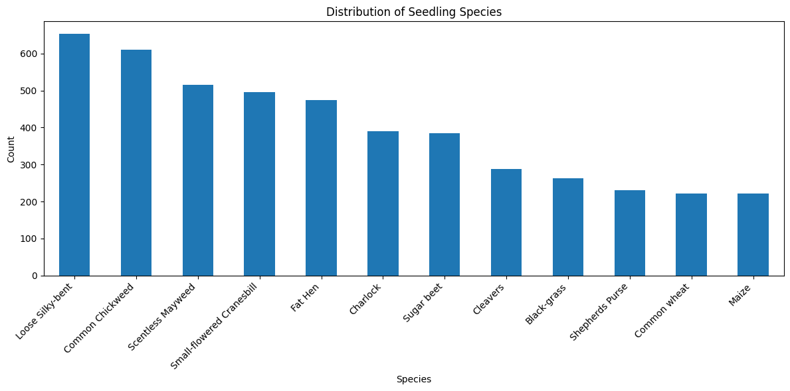
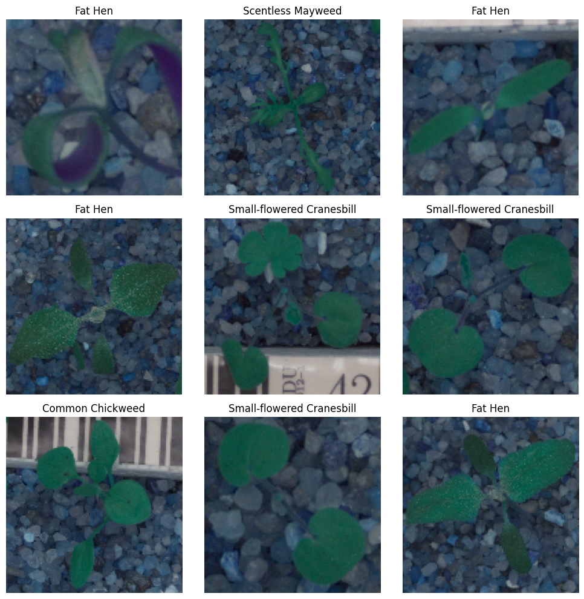

# Seedling Image Classifier

## Overview
This project applies deep learning to a computer vision classification task involving plant seedlings. The notebook covers image preprocessing, model training, and evaluation for a multi-class image classification problem.

The trained model is included. To reproduce preprocessing and training, [download the original 223 MiB image array and verify its checksum](data/README.md).

## How a botanist could use the labels

Distinguishing crops from weeds early helps a field team decide which plants need attention. The classifier could give a botanist a first-pass species label while sorting images. Common wheat reached an F1 score of 0.83, while Shepherd’s Purse reached 0.42. That gap is a reason to keep expert review in the workflow before taking action in the field.

## Academic Context
Completed during my M.S. in Data Analytics at Western Governors University (WGU), then packaged here as a public portfolio project. Screenshots from the original written submission are preserved in `assets/report-extracts/`.

## What It Shows
- image preprocessing for a CNN workflow
- supervised multi-class classification
- TensorFlow/Keras deep learning workflow
- model evaluation and class labeling

## Included Files
- `notebooks/seedling_cnn_classifier.ipynb`
- `data/class_names.csv`
- `data/seedling_dataset/labels.csv`
- `data/README.md`
- `models/seedling_classifier_model.keras`
- `models/README.md`
- `requirements.txt`

## What Works Out Of The Box
- model architecture review in the notebook
- access to class labels and label metadata
- loading the trained `.keras` model for inference-oriented inspection

## Results

- The trained CNN achieved test accuracy of `0.6662` (`66.62%`) across `12` plant seedling classes.
- Class-level performance was strongest on Common Chickweed (`0.83` F1) and Common wheat (`0.83` F1).
- More visually similar species such as Shepherd's Purse (`0.42` F1), Fat Hen (`0.50` F1), and Scentless Mayweed (`0.56` F1) remained more challenging, which is typical in fine-grained image classification.

## Selected Visuals

## Rerun the training notebook

Follow the [dataset setup instructions](data/README.md) to put the images next to the included labels. The public archive matches the original coursework array.
